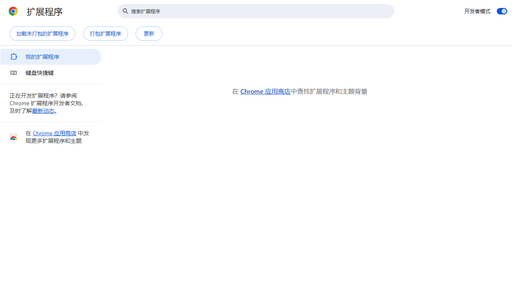
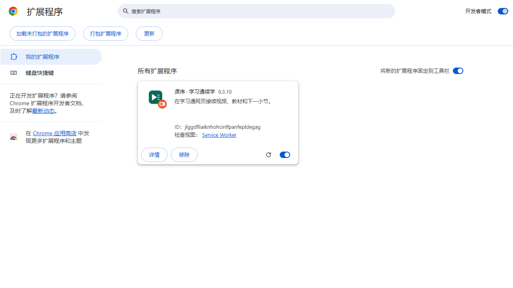

# 课序

在电脑上用学习通看课时，课序可以接着播放本节视频，逐份滚动教材和 PPT，再打开同一门课里下一个已开放的小节。你可以随时暂停。

**[下载最新版 ZIP · GitHub Releases](https://github.com/gish-fucker/kexu/releases)**

桌面 Chrome 和 Edge 使用同一个安装包。首次正式发布前，内测同学可直接使用收到的 `kexu-0.3.10-chrome.zip`，从下面第 2 步开始。

<a name="下载与安装"></a>

##<details>
<summary><strong>👉 下载与安装</strong></summary>

1. **下载安装包。** 打开上方下载入口，进入标有 **Latest** 的版本。在 **Assets（附件）** 中点文件名以 `kexu-` 开头、以 `-chrome.zip` 结尾的文件。`Source code` 是项目源码，安装课序请选择前者。
   <!-- 截图 01：docs/images/01-download.png，标出 Latest 和安装包附件。 -->
2. **解压安装包。** Windows 右键点击 ZIP 并选择「全部解压缩」，macOS 双击 ZIP。解压后找到名为 **`kexu`** 的文件夹。如果解压工具另外建了一层 `kexu-0.3.10-chrome` 文件夹，打开它就能看到 `kexu`。把整个 `kexu` 文件夹放在准备长期保留的位置，例如「文档」里。
   <!-- 截图 02：docs/images/02-extract.png，显示解压后 manifest.json 所在的一层。 -->
3. **打开扩展管理页。** 在 Chrome 地址栏输入 `chrome://extensions/`；使用 Edge 时输入 `edge://extensions/`。按回车。

   

4. **打开开发者模式。** Chrome 的开关在页面右上方。Edge 在扩展管理页打开「开发人员模式」，窄窗口下可先展开左侧菜单。开启后会出现加载扩展的按钮。

   

5. **加载课序。**
   - **Chrome** 点「加载未打包的扩展程序」或「加载已解压的扩展程序」。
   - **Edge** 点「加载解压缩的扩展」。

   在弹出的窗口里，找到第 2 步保存的位置，**选中整个 `kexu` 文件夹**，再点「选择文件夹」或「打开」。例如，你把它放在「文档」里，这一步就选 **文档 → kexu**。
   <!-- 截图 05：docs/images/05-load-folder.png，标出所选文件夹和确认按钮。 -->
6. **确认安装。** 管理页出现「课序 · 学习通续学」，开关显示已启用。卡片上的版本号可用于核对更新。

   

7. **固定到工具栏。** 点击浏览器右上角的「扩展程序」拼图图标。Chrome 点课序旁的图钉。Edge 点课序旁的眼睛图标，或在「…」菜单选择「在工具栏中显示」。点击课序图标会看到简短的使用提示。

   

   图中左侧带白色播放符号的绿色图标就是课序。

</details>

## 开始使用

1. 在电脑浏览器登录学习通，进入已选课程，打开「章节」目录，点一个已开放的**视频或教材小节**。打开后应能看到播放器、教材阅读器或「慕课视频」「教材+PPT」等页签。如果安装时已经开着这个小节，先刷新一次。
2. 找到**课程页面右下角**的「课序」。如果只看到标题，点击标题展开。无需填写账号或调整参数，直接点「开始」。
   <!-- 截图 08：docs/images/08-start.png，保留课程页签、课序位置和开始按钮。 -->
3. 看面板里的小节名称和状态文字，例如「正在播放」「正在滚动教材」或「正在检查本页下方是否还有资料」。可以切换标签页，也可以点击面板标题收起状态。
4. 要停下来，点「暂停」。按钮变回「开始」后，你可以继续或自行选择其他小节。手动切节后，在新小节重新点「开始」。

## 常见问题

## 问题反馈

请写清**课序版本、浏览器及版本、任务类型、操作步骤、预期结果和面板原文**。如果问题只在后台出现，请写明切走了多久、切回来看到什么。截图请遮住姓名、学号、学校、班级和地址栏参数。无需提供账号、Cookie 或完整课程链接。[提交 GitHub Issue](https://github.com/gish-fucker/kexu/issues/new)

<details>
<summary>开发与兼容性记录</summary>

本项目使用 WXT、TypeScript 和 Manifest V3。使用 Node.js 24.15 或更新的 24.x 版本，在项目根目录依次运行：

```sh
npm ci
npm run typecheck
npm test
npm run zip
```

可加载的目录为 `.output/chrome-mv3`，安装包在 `.output/`。调试自制课程时运行 `npm run build:demo` 和 `npm run demo`，加载 `.output/chrome-mv3-demo`，在浏览器打开 `http://localhost:4173`。[兼容性及历史测试记录](docs/compatibility.md)

</details>
