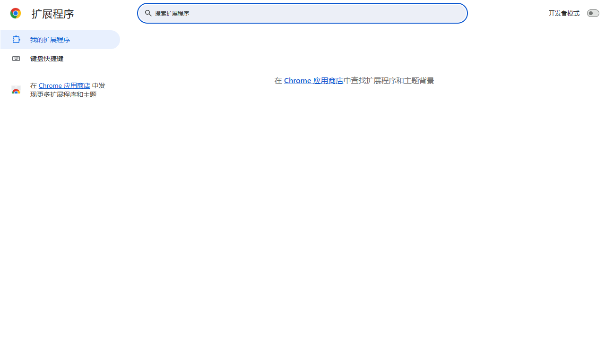

# 课序

在电脑上用学习通看课时，课序可以接着播放本节视频，逐份滚动教材和 PPT，再打开同一门课里下一个已开放的小节。你可以随时暂停。

**[下载最新版 ZIP · GitHub Releases](https://github.com/gish-fucker/kexu/releases)**

桌面 Chrome 和 Edge 使用同一个安装包。首次正式发布前，内测同学可直接使用收到的 `kexu-0.3.10-chrome.zip`，从下面第 2 步开始。

## 下载与安装

1. **下载安装包。** 打开上方下载入口，进入标有 **Latest** 的版本。在 **Assets（附件）** 中点文件名以 `kexu-` 开头、以 `-chrome.zip` 结尾的文件。`Source code` 是项目源码，安装课序请选择前者。
   <!-- 截图 01：docs/images/01-download.png，标出 Latest 和安装包附件。 -->
2. **解压安装包。** Windows 右键点击 ZIP 并选择「全部解压缩」，macOS 双击 ZIP。解压后找到名为 **`kexu`** 的文件夹。如果解压工具另外建了一层 `kexu-0.3.10-chrome` 文件夹，打开它就能看到 `kexu`。把整个 `kexu` 文件夹放在准备长期保留的位置，例如「文档」里。
   <!-- 截图 02：docs/images/02-extract.png，显示解压后 manifest.json 所在的一层。 -->
3. **打开扩展管理页。** 在 Chrome 地址栏输入 `chrome://extensions/`；使用 Edge 时输入 `edge://extensions/`。按回车。

   

4. **打开开发者模式。** Chrome 的开关在页面右上方。Edge 在扩展管理页打开「开发人员模式」，窄窗口下可先展开左侧菜单。开启后会出现加载扩展的按钮。

   

5. **加载课序。**
   - **Chrome** 点「加载未打包的扩展程序」或「加载已解压的扩展程序」。
   - **Edge** 点「加载解压缩的扩展」。

   在弹出的窗口里，找到第 2 步保存的位置，**选中整个 `kexu` 文件夹**，再点「选择文件夹」或「打开」。例如，你把它放在「文档」里，这一步就选 **文档 → kexu**。
   <!-- 截图 05：docs/images/05-load-folder.png，标出所选文件夹和确认按钮。 -->
6. **确认安装。** 管理页出现「课序 · 学习通续学」，开关显示已启用。卡片上的版本号可用于核对更新。

   

7. **固定到工具栏。** 点击浏览器右上角的「扩展程序」拼图图标。Chrome 点课序旁的图钉。Edge 点课序旁的眼睛图标，或在「…」菜单选择「在工具栏中显示」。点击课序图标会看到简短的使用提示。

   

   图中左侧带白色播放符号的绿色图标就是课序。

## 开始使用

1. 在电脑浏览器登录学习通，进入已选课程，打开「章节」目录，点一个已开放的**视频或教材小节**。打开后应能看到播放器、教材阅读器或「慕课视频」「教材+PPT」等页签。如果安装时已经开着这个小节，先刷新一次。
2. 找到**课程页面右下角**的「课序」。如果只看到标题，点击标题展开。无需填写账号或调整参数，直接点「开始」。
   <!-- 截图 08：docs/images/08-start.png，保留课程页签、课序位置和开始按钮。 -->
3. 看面板里的小节名称和状态文字，例如「正在播放」「正在滚动教材」或「正在检查本页下方是否还有资料」。可以切换标签页，也可以点击面板标题收起状态。
4. 要停下来，点「暂停」。按钮变回「开始」后，你可以继续或自行选择其他小节。手动切节后，在新小节重新点「开始」。

## 功能与设置

| 面板上看到的内容 | 怎么用 |
| --- | --- |
| 课序标题、版本号、小节名称 | 点标题可收起或展开。收起期间会继续运行。 |
| 开始／暂停 | 控制当前小节的续学。暂停时，正在接管的视频会暂停，资料也会停止滚动。 |
| 静音标签页／取消静音 | 切换整个课程标签页的声音，只影响这一个标签页。 |
| 开启视频声音 | 带声播放受浏览器限制时，课序会尝试静音续播。这时可点此按钮恢复视频声音。如果整个标签页也已静音，还需点「取消静音」。 |
| 待核对小节 | 到达目录末尾或遇到未开放的小节时，面板会按目录核对已记录的任务。按提示回到列出的小节，查看学习通的完成标记。 |

<!-- 截图 09：docs/images/09-panel.png，标出小节名称、状态、暂停和静音。 -->

## 常见问题

**提示无法加载扩展或找不到清单文件？**

打开解压位置，找到 `kexu` 文件夹。双击进去应能看到 `manifest.json`、`popup.html` 和 `icons`。回到扩展管理页重新加载，选择这一层文件夹。如果看到 `package.json` 和 `entrypoints`，请回到 Releases 下载附件里的安装包。这个 ZIP 用于桌面浏览器，Chrome 的最低声明版本为 120。iPhone、iPad 和学习通 App 无法用这个 ZIP 安装。

**装好了，课程页面上没有面板？**

到扩展管理页确认课序已启用，并允许它在学习通网站运行。回到学习通，从课程目录进入具体小节并刷新。扩展支持超星域名下通过 HTTPS 打开的 `studentstudy` 学习页。课程首页、学校门户和单独打开的文档预览页请先返回章节目录。

**视频不动、没声音，或遇到了题目？**

先看播放器和面板提示。浏览器拦截播放时，手动点击播放器中央的播放键；若面板已恢复「开始」，再点一次。需要声音时，检查面板上的两种声音按钮。遇到互动题，请自行处理，再回到视频继续。独立的图谱、讨论和测验小节被略过后仍可从目录进入。课程任务请按任课教师和学习通的要求完成。

**PPT 到底了，或章节切换和预期不同？**

一节可能有多份资料。课序会继续检查下方延迟加载的内容，并再次确认阅读器底部。如果提示无法读取，请打开对应的教材页签，在文档里面手动滚动。提示「后续小节尚未开放」时，查看学习通目录给出的开放条件。进度以学习通显示为准；看到「待核对小节」时，按名称回到目录逐项查看。

**切到后台还能继续吗？**

保留课程标签页，切到其他标签页时课序会尝试继续。浏览器冻结或丢弃标签页、电脑休眠、登录过期都会影响进度。切回来先看面板和播放器，有「开始」按钮时可点它恢复。

**怎么更新？**

先在课序面板点「暂停」。将新版 ZIP 解压到临时位置，打开里面的 `kexu` 文件夹，把里面的全部文件和子文件夹复制到浏览器原先加载的文件夹，提示同名时选择替换。旧版文件夹可以保留原名。到扩展管理页，在课序卡片上点「重新加载」或刷新箭头，再刷新课程页，通过面板标题核对版本号。

**如何提交诊断记录？**

普通反馈贴出面板提示即可。如果需要记录后台切换或阅读器卡住的过程，可以使用仓库里的独立工具「课序诊断」。在仓库首页点 **Code → Download ZIP**，解压源码，按安装时的方法单独加载其中的 `tools/observer` 文件夹。刷新学习通小节页，从工具栏打开**课序诊断**，点「开始记录」，复现问题后回到该页再点「结束记录」→「复制记录」。新记录会替换上一份。检查内容并遮去个人信息后，粘贴到 Issue。用完可从扩展管理页移除诊断工具。[查看诊断工具](tools/observer)

## 问题反馈

请写清**课序版本、浏览器及版本、任务类型、操作步骤、预期结果和面板原文**。如果问题只在后台出现，请写明切走了多久、切回来看到什么。截图请遮住姓名、学号、学校、班级和地址栏参数。无需提供账号、Cookie 或完整课程链接。[提交 GitHub Issue](https://github.com/gish-fucker/kexu/issues/new)

## 隐私与许可证

课序沿用当前网页的登录状态。扩展声明的权限是 `storage`，用于在浏览器会话中按标签页暂存跨节接续所需的课程、班级、目标小节编号及短时有效的跳转信息。课程页的 `sessionStorage` 保存本标签页待核对的小节名称、编号和任务标签。标签页静音通过浏览器的标签页接口操作。

课程脚本只匹配超星域名下的三种 `studentstudy` 路径，跨域阅读器脚本匹配 `pan-yz.chaoxing.com/screen/v2/`。扩展通过网页播放器、阅读器和目录操作课程，视频、文档和页面跳转由学习通正常联网。课序没有统计服务、远程脚本或向作者上传记录的网络请求，也不读取账号密码或 Cookie。独立诊断工具在本机浏览器会话中保留所选标签页的记录，复制后由你决定是否提交。

项目沿用 MIT 许可证，安装包附有项目许可及运行时代码的第三方许可声明。[项目许可证](LICENSE) · [第三方声明](public/THIRD-PARTY-NOTICES.txt)

<details>
<summary>开发与兼容性记录</summary>

本项目使用 WXT、TypeScript 和 Manifest V3。使用 Node.js 24.15 或更新的 24.x 版本，在项目根目录依次运行：

```sh
npm ci
npm run typecheck
npm test
npm run zip
```

可加载的目录为 `.output/chrome-mv3`，安装包在 `.output/`。调试自制课程时运行 `npm run build:demo` 和 `npm run demo`，加载 `.output/chrome-mv3-demo`，在浏览器打开 `http://localhost:4173`。[兼容性及历史测试记录](docs/compatibility.md)

</details>
